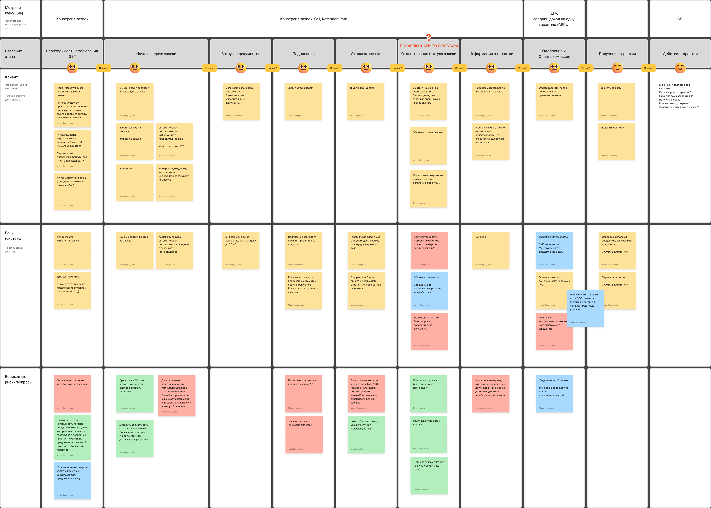
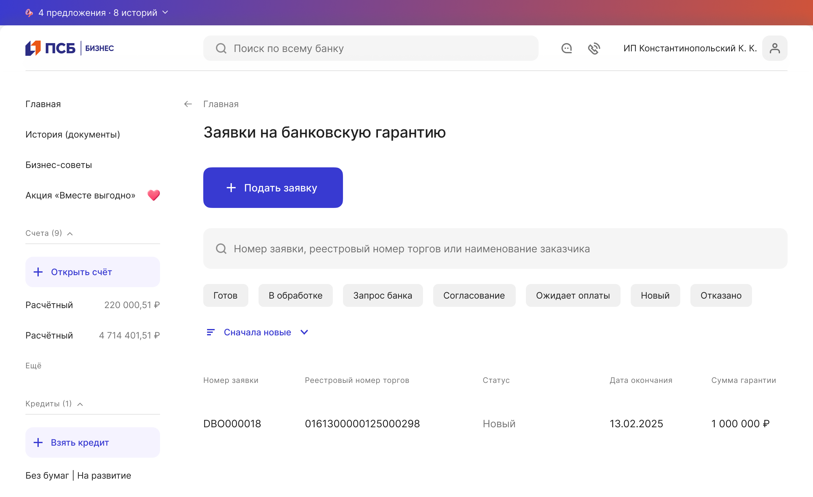
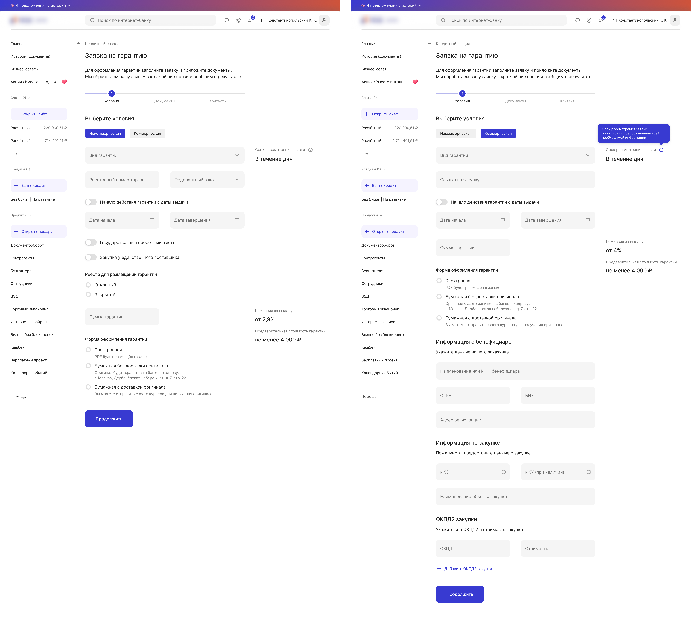
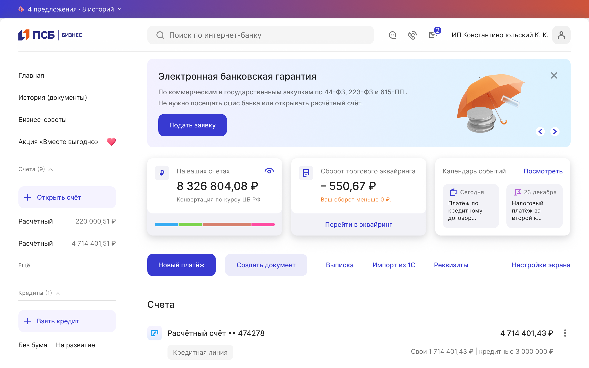

Я спроектировала сервис электронных банковских гарантий для предпринимателей. Начала с записей интервью и отчётов предыдущего исследования: они позволили восстановить путь от поиска закупки до момента, когда заказчику понадобится готовая гарантия.

## Почему гарантиям нужен отдельный раздел

Предприниматели хранят десятки гарантий и иногда возвращаются за документом спустя годы. В интервью они описывали гарантии как самостоятельный инструмент. Я предложила отдельный раздел, где рядом видны статусы заявок и доступны документы для скачивания. Арт-директор поддержал концепцию, а реализацию раздела отложили из-за технических ограничений.

## Что нужно знать до отправки заявки

Участники интервью хотели заранее увидеть комиссию, проверить данные бенефициара и приложить документы. Я учла это в сценарии оформления. Для тех, кто не помнит номер закупки, предложила ссылку на государственный реестр прямо в заявке.

## Кому показать предложение

Я предложила показывать баннер клиентам, которые уже оформляли гарантии, открыли специальный счёт или регулярно участвуют в тендерах. Команда согласовала этот подход.

Концепцию сервиса согласовали и подготовили к реализации. Затем приоритеты банка изменились, и разработку приостановили.
