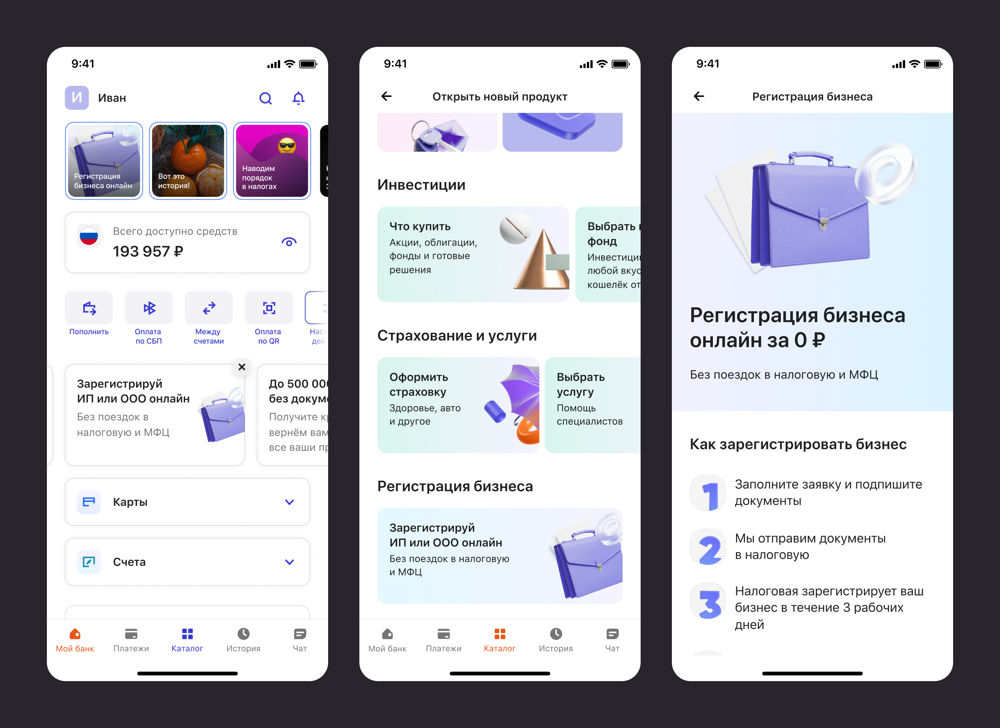
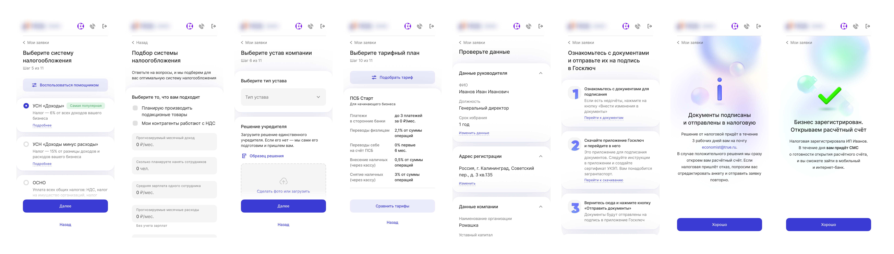
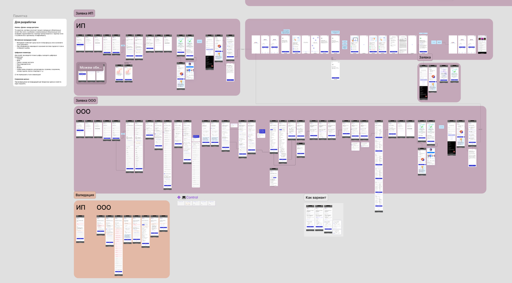

## С чего начинали

Клиенты банка могли подать заявку на регистрацию бизнеса только с компьютера. Чтобы подписать документы, требовалась встреча с менеджером.

Я спроектировала дистанционный путь для тех, кто впервые открывает ИП или ООО. В моей концепции клиент начинает регистрацию в приложении банка, подписывает документы через Госключ и отправляет их в ФНС. Я отвечала за прототип и адаптивные макеты, а границы первой версии определила вместе с командой.

## Разобрала путь для ИП и ООО

Я прошла существующий сценарий глазами клиента. Шаги, для которых нужен реальный бизнес, изучила по записям. Отдельно разобрала подписание через Госключ и сравнила решения конкурентов.

## Связала заявку, подписание и отправку в ФНС

В интерактивном прототипе показала, как клиент переходит из приложения банка к подписанию документов в Госключе и отправляет заявление без встречи с менеджером.

## Предложила три способа начать регистрацию

Для тех, кто сам ищет услугу, предложила раздел «Для бизнеса» в каталоге. Для знакомства с сервисом — баннер на главной, который можно скрыть, и сторис с переходом на страницу регистрации.

## Разделила анкету на короткие шаги

- **Данные компании.** Разбила большую форму на несколько экранов. Телефон подставляется из приложения, его можно изменить.
- **Налоговый режим и тариф.** Отвела каждому выбору отдельный шаг. Для выбора режима спроектировала помощник.
- **Документы.** Добавила шаблон гарантийного письма и образец решения учредителя. Перед отправкой заявки предусмотрела экран проверки данных.

## Защитила концепцию и подготовила MVP

Я представила решение владельцу продукта, руководителю направления и команде.

По итогам обсуждений концепция была согласована, после чего совместно с командой мы определили состав MVP.

На интервью могу показать полный путь для ИП и ООО, интерактивный прототип дистанционной регистрации и финальные макеты MVP.
