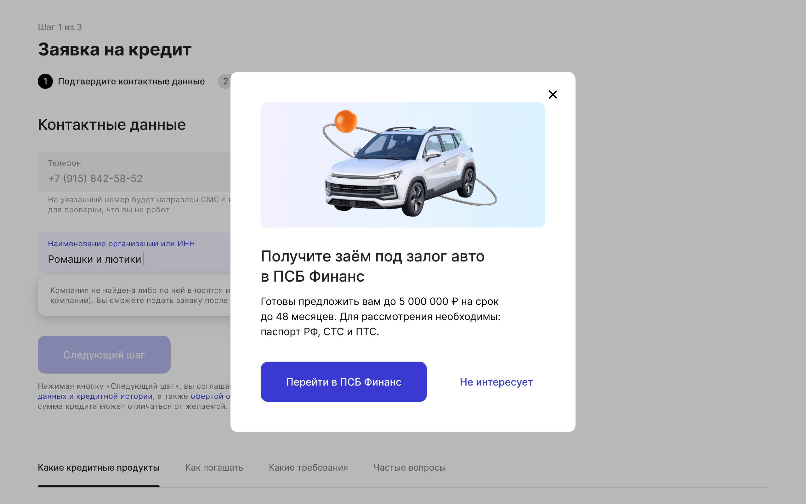

Я спроектировала для малого и среднего бизнеса работу с возобновляемой кредитной линией в интернет-банке и мобильном приложении. После одобрения заявки клиент может получать деньги частями, досрочно погашать долг и закрыть договор. Весь этот путь вошёл в релиз.

## Где пригодились знакомые формы

За основу я взяла формы других кредитных продуктов банка. При оформлении транша заметила лишнее действие: даже клиенту с одним счётом предлагали выбрать его в списке. Теперь в таком случае сразу показан номер счёта. Команда реализовала это изменение.

## Как оценить досрочное погашение

Из исследований других кредитных продуктов мы знали, что клиенту важно увидеть, как изменятся платежи. Я предложила показывать предварительный график сразу после ввода суммы. Так последствия погашения можно оценить до отправки заявки.

## Что предложить, если заявка приостановлена

Я предложила показать клиентам альтернативу — партнёрский заём под залог автомобиля. Мы предусмотрели предложение и в процессе оформления, и на экране приостановленной заявки. После запуска клиенты переходили в партнёрский сервис и оформляли займы.

<a href="https://www.figma.com/proto/LJ1Yil4rLZfSgMmq5gObZ3/%F0%9F%92%8E-%D0%9C%D1%83%D0%BB%D1%8C%D1%82%D0%B8%D1%80%D0%B5%D1%88%D0%B5%D0%BD%D0%B8%D0%B5-%F0%9F%92%BB---%D0%92%D0%9A%D0%9B-%D0%91%D0%91%D0%A0--%D0%92%D0%9A%D0%9B-%D0%92%D0%9A%D0%9B-%D0%A1%D0%B5%D0%BB%D0%BB%D0%B5%D1%80%D1%8B----%E2%9C%A8-%D0%9C%D0%B0%D1%88%D0%B0-%D0%9A--Copy-?node-id=4004-104027&amp;viewport=215%2C204%2C0.04&amp;t=CuBIVuf5CTr7WI7H-1&amp;scaling=min-zoom&amp;content-scaling=fixed&amp;starting-point-node-id=4004%3A104027&amp;page-id=4004%3A88778" target="_blank" rel="noopener noreferrer">Презентация</a>
