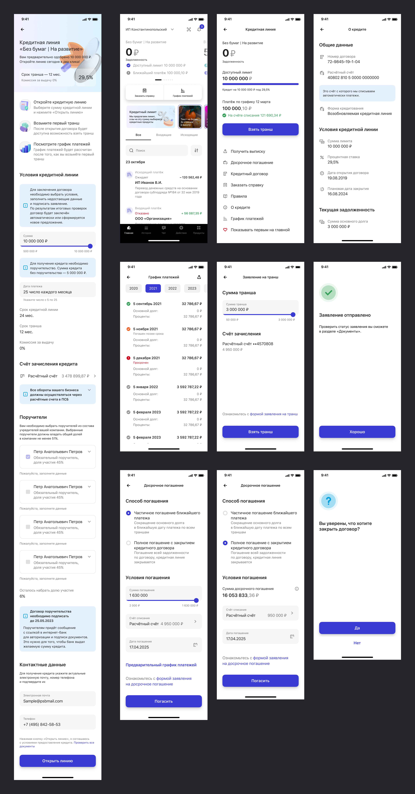

## О проекте

Проект по запуску нового кредитного продукта для действующих клиентов малого и среднего бизнеса.

Моя задача заключалась в том, чтобы спроектировать полный пользовательский путь работы с возобновляемой кредитной линией: от подачи заявки до сопровождения кредита, получения траншей и досрочного погашения.

В рамках проекта я подготовила сценарии для интернет-банка и мобильного приложения, а также адаптировала существующие решения банка под особенности нового кредитного продукта.

## Моя роль

Я отвечала за проектирование пользовательского опыта нового кредитного продукта.

В мои задачи входило:

- анализ существующих кредитных продуктов банка
- анализ решений конкурентов
- проектирование пользовательского сценария интернет-банка
- адаптация сценария для мобильного приложения
- подготовка сценариев получения транша и досрочного погашения
- проектирование раздела сопровождения кредитной линии
- проведение дизайн-ревью
- взаимодействие с разработчиками и Product Owner

## Спроектировала полный жизненный цикл кредитного продукта

В отличие от большинства кредитных сценариев, проект охватывал не только оформление заявки.

Мне предстояло спроектировать весь путь пользователя после получения кредитной линии.

В результате был реализован полный цифровой цикл работы с продуктом:

- подача заявки
- получение решения
- раздел сопровождения кредитной линии
- получение нового транша
- частичное досрочное погашение
- полное закрытие кредитного договора

## Использовала существующие решения там, где они уже работали

В банке уже существовали цифровые продукты, оформляемые в рамках кредитного лимита.

Поэтому моей задачей было не создавать новые интерфейсы ради новых интерфейсов, а переиспользовать удачные паттерны и сохранить единый пользовательский опыт.

Новые решения проектировались только там, где существующих сценариев было недостаточно или они не учитывали особенности возобновляемой кредитной линии.

Такой подход позволил сохранить консистентность продукта и упростить дальнейшую разработку.

## Улучшила существующие сценарии вместо механического переиспользования

Хотя большая часть экранов основывалась на существующих кредитных формах, я не ограничилась их переносом.

Во время проектирования предложила несколько улучшений.

Например, в одном из сценариев сообщения об ошибках были реализованы как произвольный текст красного цвета с техническими формулировками.

Я заменила их на стандартный паттерн дизайн-системы, переписала тексты простым языком и использовала привычный для пользователей формат уведомлений.

Это позволило сделать интерфейс более понятным и единообразным.

## Упростила оформление транша

В существующем сценарии пользователь всегда видел поле выбора счёта.

Я предложила отказаться от селекта, если счёт всего один.

В этом случае номер счёта отображается как информационное поле без возможности выбора.

Пользователю не приходится взаимодействовать с элементом интерфейса, который не предполагает никакого действия.

Команда поддержала это решение и реализовала его в продукте.

## Помогла пользователю принять решение о досрочном погашении

При проектировании сценария частичного досрочного погашения я предложила показывать предварительный график платежей ещё до отправки заявки.

Это решение основывалось на исследованиях других кредитных продуктов банка, которые показали, что пользователям важно заранее понимать, как изменится график после внесения суммы.

Благодаря этому пользователь может оценить последствия своего решения ещё до отправки заявки.

## Взаимодействовала с&nbsp;разработкой и дизайн-системой

Проект реализовывался сразу для нескольких платформ: интернет-банка, iOS и Android.

Во время реализации я регулярно проводила дизайн-ревью, обсуждала решения с разработчиками и выявляла расхождения между реализацией компонентов на разных платформах.

Обнаруженные несоответствия передавала команде дизайн-системы, чтобы постепенно повышать консистентность интерфейсов и уменьшать количество подобных проблем в будущих проектах.

## Результаты

В рамках проекта был запущен полный цифровой сценарий работы с возобновляемой кредитной линией.

В релиз вошли:

- оформление заявки
- раздел сопровождения кредитной линии
- получение транша
- частичное досрочное погашение
- полное закрытие кредитного договора
- адаптивная версия интернет-банка
- мобильное приложение

После запуска продукт стал доступен действующим клиентам банка.

По внутренним данным банка новый продукт показал высокий спрос и стал одним из инструментов развития кредитного направления для малого и среднего бизнеса.

Из-за NDA точные показатели не публикую. На интервью могу подробнее рассказать о результатах проекта.

## За кадром

Из-за NDA в кейсе показана только часть материалов.

На интервью могу показать:

- полный пользовательский сценарий
- макеты интернет-банка и мобильного приложения
- все этапы работы с кредитной линией — от подачи заявки до закрытия договора
- сценарии получения транша и досрочного погашения
- рекламные материалы и сценарии продвижения партнёрского продукта

<a href="https://www.figma.com/proto/LJ1Yil4rLZfSgMmq5gObZ3/%F0%9F%92%8E-%D0%9C%D1%83%D0%BB%D1%8C%D1%82%D0%B8%D1%80%D0%B5%D1%88%D0%B5%D0%BD%D0%B8%D0%B5-%F0%9F%92%BB---%D0%92%D0%9A%D0%9B-%D0%91%D0%91%D0%A0--%D0%92%D0%9A%D0%9B-%D0%92%D0%9A%D0%9B-%D0%A1%D0%B5%D0%BB%D0%BB%D0%B5%D1%80%D1%8B----%E2%9C%A8-%D0%9C%D0%B0%D1%88%D0%B0-%D0%9A--Copy-?node-id=4004-104027&amp;viewport=215%2C204%2C0.04&amp;t=CuBIVuf5CTr7WI7H-1&amp;scaling=min-zoom&amp;content-scaling=fixed&amp;starting-point-node-id=4004%3A104027&amp;page-id=4004%3A88778" target="_blank" rel="noopener noreferrer">Презентация</a>
