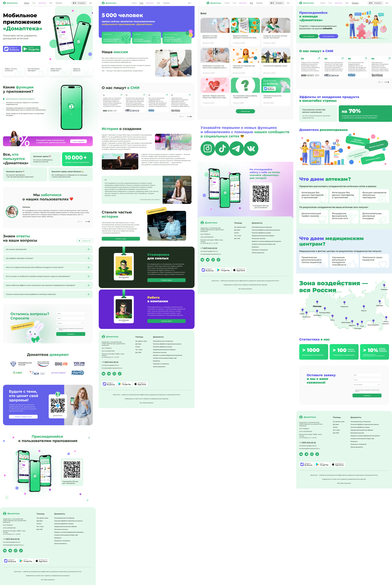
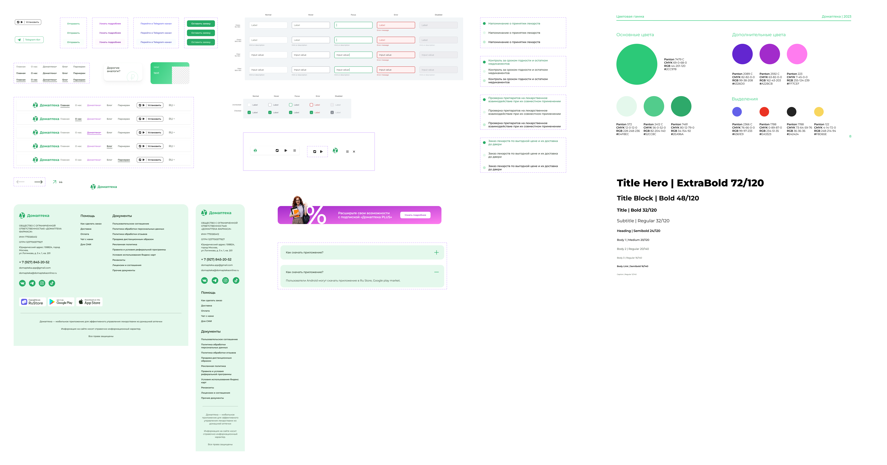

Я была первым дизайнером Домаптеки. Спроектировала сайт, разработала визуальный стиль и нарисовала маскота. Сайт должен был объяснять сервис сразу нескольким аудиториям: будущим пользователям, аптечным сетям, инвесторам и кандидатам в команду.

## Один сайт для разных аудиторий

Я изучила рынок цифровых медицинских сервисов и помогла определить структуру сайта. На главной можно познакомиться с продуктом, а для аптечных сетей мы предусмотрели отдельную страницу о партнёрстве.

## Из визуального стиля в рабочие компоненты

Я собрала брендбук и подготовила графику для соцсетей. Для работы над интерфейсом оформила UI Kit: палитру, типографику, компоненты и их состояния.

