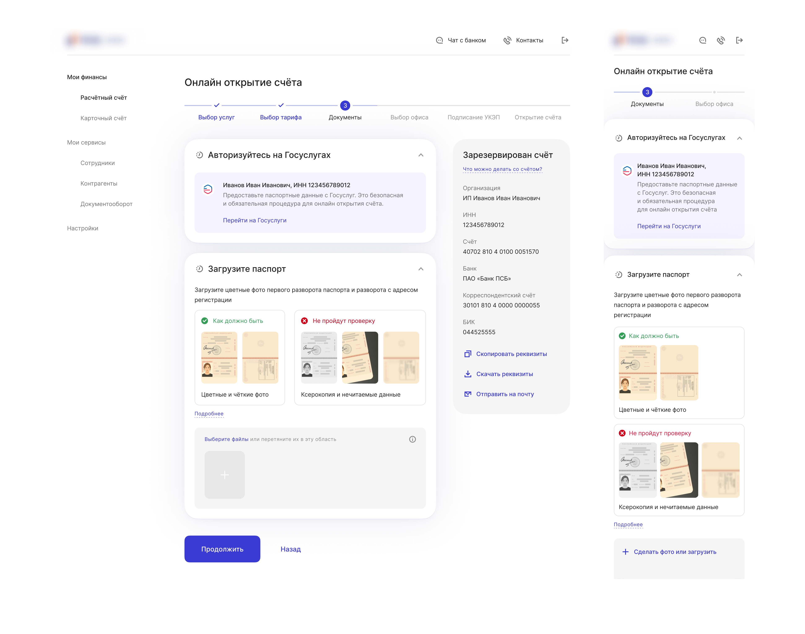
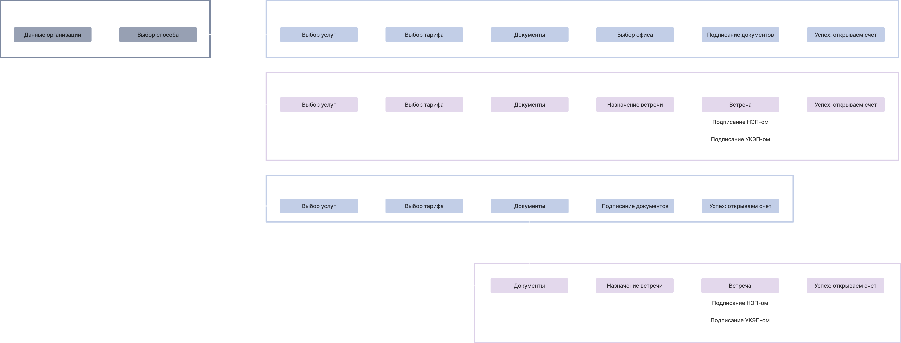
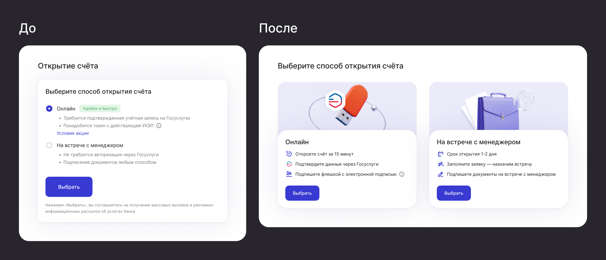
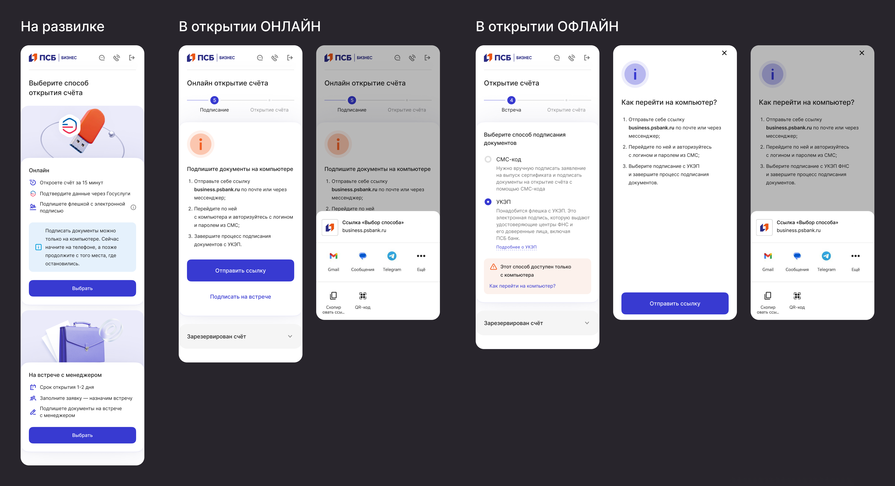
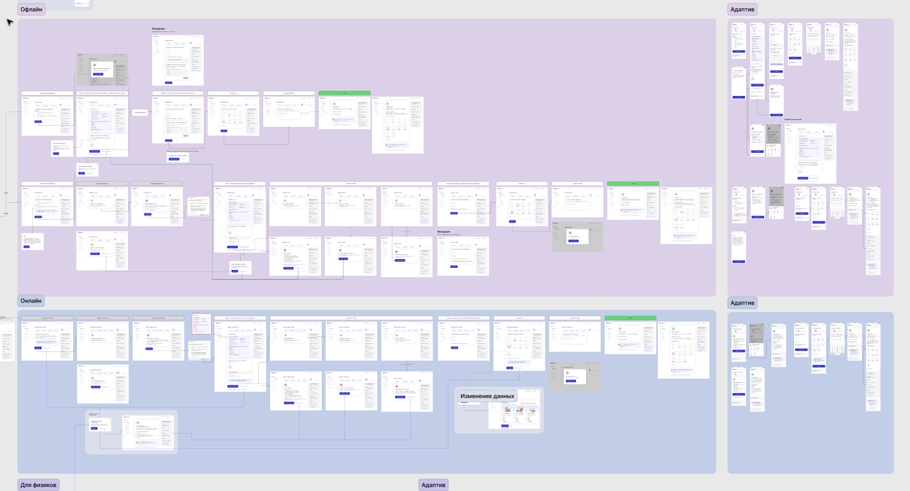
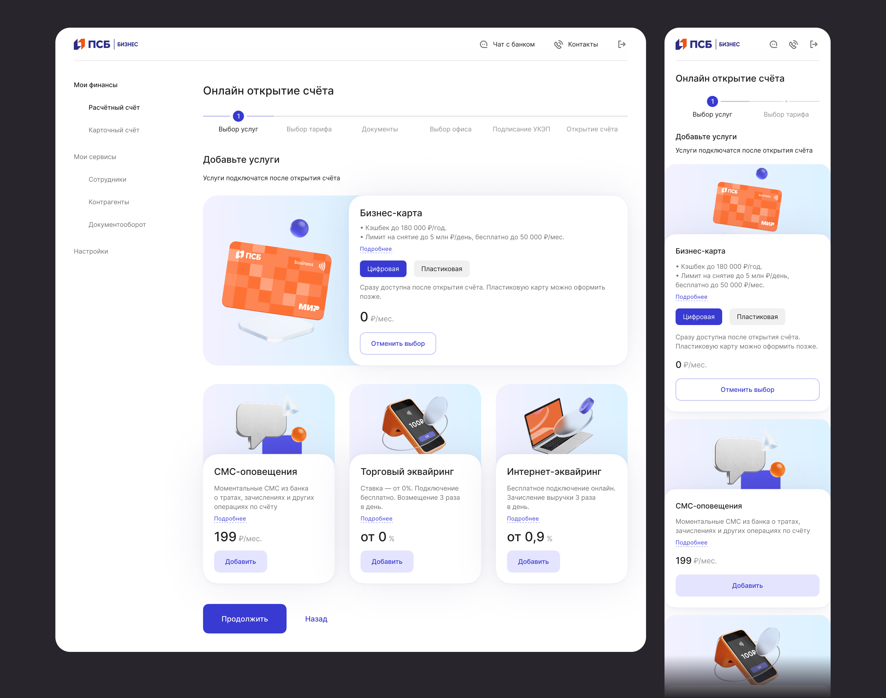

С 2025 года я проектирую открытие расчётного счёта для ИП и ООО. Раньше клиент заполнял заявку онлайн, а документы подписывал на встрече с менеджером. Мы запустили дистанционное оформление для клиентов с действующей электронной подписью и после релиза проверили, где они прерывают заявку.

## На этапе документов стало уходить вдвое меньше клиентов

По обращениям в контакт-центр и исследованиям мы с исследователем выяснили, где возникали трудности. Клиенты путались, кто должен войти через Госуслуги, ошибались при съёмке паспорта и застревали, если данные изменились.

Я уточнила, кто проходит авторизацию, добавила подсказки к фотографиям и возможность обновить паспортные данные. После изменений число клиентов, прекращавших оформление на этом этапе, снизилось более чем вдвое.

## Когда предложить онлайн-оформление

Я предложила выбирать способ открытия после ввода данных организации. К этому моменту у клиента уже есть личный кабинет, а заявка сохранена в CRM.

После релиза мы увидели, что даже клиенты с электронной подписью часто выбирали встречу. Мы переработали экран выбора, и доля онлайн-оформлений выросла.

## Как продолжить заявку с компьютера

Начать можно с телефона, но для подписи нужен компьютер. Я связала мобильный и десктопный сценарии так, чтобы клиент продолжил с того же места.

Подписание зависит от сертификата и установленного ПО. Я разделила процесс на шаги и для каждого типа подписи объяснила, что сделать дальше.

## Как выбрать дополнительные услуги

На тестах люди не понимали, как убрать предвыбранную услугу и когда она подключится. Я изменила механику выбора и указала сроки подключения прямо на экране.

