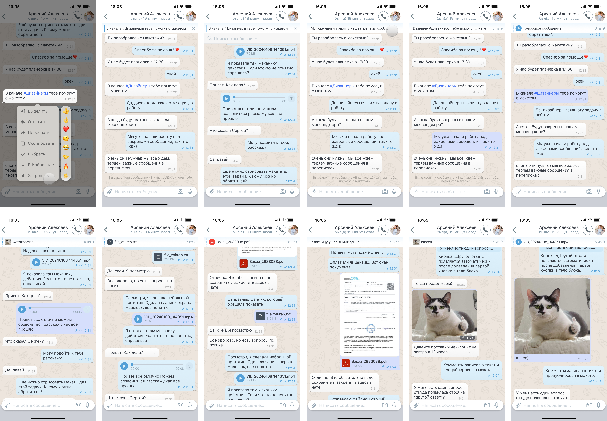
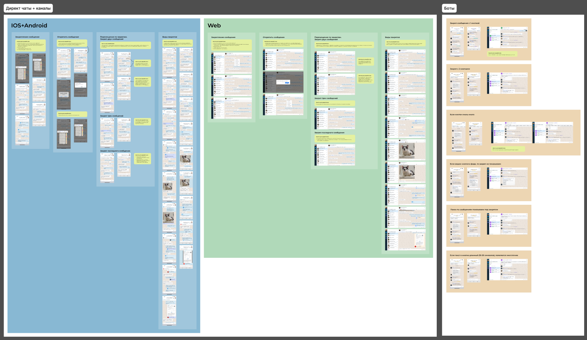

Как найти нужное сообщение, когда в чате несколько закрепов? Вместе с владельцем продукта мы выбрали компактную панель вверху переписки. Первым видно последнее закреплённое сообщение, а нажатие переключает закрепы прямо в чате.

## Как понять, где ты в переписке

Я предложила показывать номер закрепа, например «2 из 10», и подсвечивать сообщение при переходе. Повторное нажатие возвращает к последнему сообщению. Число закрепов мы оставили без ограничения.

## Как проверить механику до разработки

Я проработала состояния для сообщений бота и обычных сообщений, событие о закреплении в истории чата и подтверждение при снятии последнего закрепа. На интерактивном прототипе мы с владельцем продукта проверили переходы и уточнили логику перед передачей в разработку.

