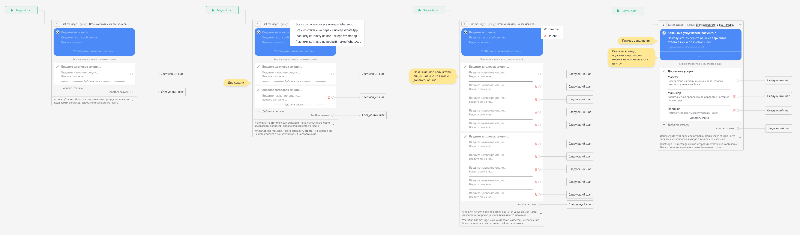

В Kommo я спроектировала шаг чат-бота, который отправляет клиенту меню в WhatsApp. Например, бот предлагает выбрать услугу, а клиент отвечает нажатием на нужный пункт. Мне нужно было решить, где автор бота найдёт это меню и как его настроит.

## Где добавить меню

Я сравнила пять вариантов, среди них — шаблон сообщения, настройка канала WhatsApp и отдельный шаг конструктора. Вместе с командой выбрали отдельный шаг: автор видит меню в том месте, где собирает последовательность действий бота.

## Как настроить варианты ответа

В одной форме автор пишет текст сообщения, задаёт название кнопки и группирует пункты меню по секциям. При проектировании я учла ограничения WhatsApp: число вариантов ограничено, а клиент может выбрать только один ответ.

Функцию выпустили в конструкторе ботов Kommo.
