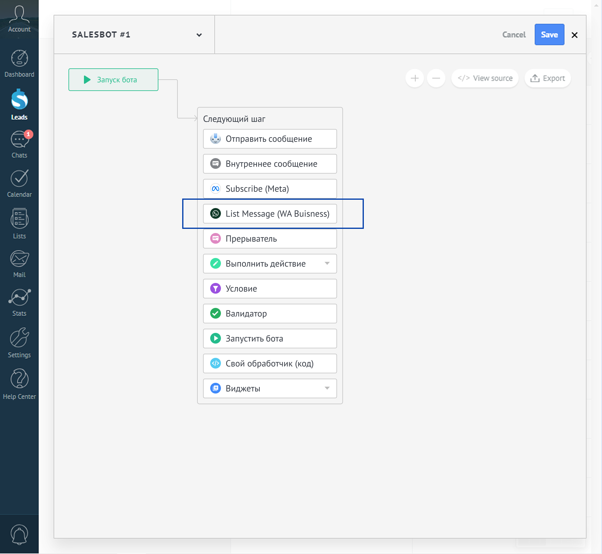

## О проекте

Проект по интеграции нового типа сообщений WhatsApp Business API в визуальный конструктор ботов Kommo.

Моя задача заключалась не только в проектировании интерфейса настройки List Message, но и в поиске оптимальной точки входа для новой функциональности внутри конструктора ботов.

## Моя роль

Я отвечала за проектирование пользовательского опыта новой функциональности.

В мои задачи входило:

- изучение возможностей WhatsApp Business API
- анализ ограничений нового типа сообщений
- поиск оптимальной точки входа внутри конструктора
- проектирование интерфейса настройки List Message
- согласование решения с продуктовой командой

## Искала правильную точку входа

Самой интересной частью проекта стало не проектирование формы настройки, а поиск места новой функциональности внутри конструктора.

Мне важно было не просто добавить ещё один шаг, а встроить новую возможность так, чтобы она была понятна пользователям и не усложнила существующий сценарий создания бота.

Я подготовила несколько вариантов интеграции новой функции.

Рассматривались различные сценарии:

- отдельный шаблон сообщений
- новый тип обычного сообщения
- автоматическое предложение перейти на List Message
- отдельный шаг конструктора
- новый раздел в настройках WhatsApp

Для каждого варианта были сформулированы преимущества и недостатки с точки зрения пользовательского опыта, масштабируемости продукта и сложности реализации.

В результате команда выбрала вариант с отдельным шагом конструктора как наиболее понятный для пользователей и соответствующий долгосрочной стратегии развития продукта.

## Спроектировала настройку сложной структуры сообщения

Одной из задач было сделать настройку достаточно гибкой, но не перегруженной.

Интерфейс позволял пользователю последовательно настроить:

- заголовок
- основной текст
- подпись
- название кнопки
- секции
- варианты выбора
- описание каждого варианта

Несмотря на ограничения API, настройка выглядела как единая форма и позволяла легко контролировать структуру сообщения.

## Проектировала с учётом будущего развития продукта

Во время поиска точки входа я думала не только о текущей задаче.

Например, один из вариантов позволял бы в будущем добавить аналогичные типы сообщений других платформ.

Другие варианты могли усложнить интерфейс или создать ложные ожидания у пользователей.

Именно поэтому при выборе решения мы оценивали не только текущую реализацию, но и влияние на дальнейшее развитие конструктора ботов.

## Результат

Функциональность была реализована в CRM-системе Kommo.

Поскольку WhatsApp является основным каналом коммуникации для бизнеса в странах Латинской Америки, именно Kommo получила интеграцию с новым типом сообщений.

В российской версии amoCRM эта функциональность не внедрялась, так как для местного рынка она не была востребована.
